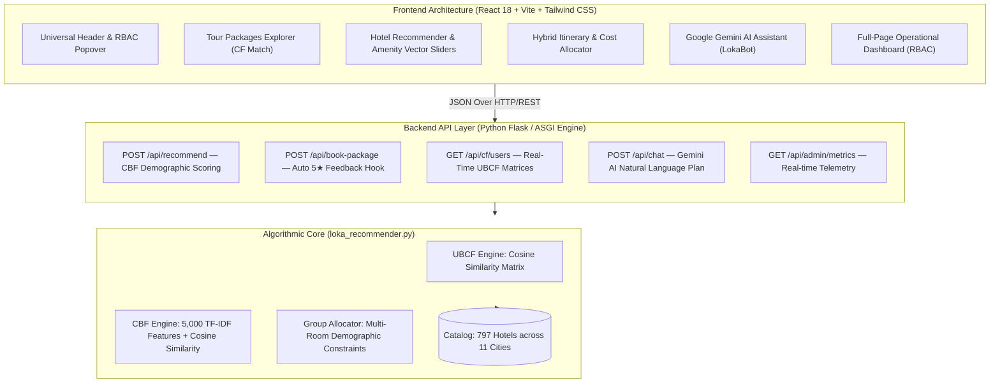

# 🧭 Loka Travel AI — Hybrid Travel Package & Group Hotel Recommendation System

[](https://lokatravel.my.id)
[](./Travel%20Package%20Recommendation%20System%20Using%20Collaborative%20Filtering%20Method%20at%20Loka%20Travel.pdf)
[-10b981?style=for-the-badge)](#published-research--mathematical-formulation)
[](#system-architecture)
[](./tests/test_recommender.py)
[](#license)

> **Author & Lead Engineer:** **Fauzi Noorsyabani** (Information Systems, Universitas Siliwangi)  
> **Co-Authors / Supervisors:** Muhammad Edi Iswanto (Politeknik Negeri Indramayu), Andi Nur Rachman (Universitas Siliwangi)  
> **Published in:** *International Journal of Applied Information Systems and Informatics (IJAISI)*, Vol. 2025, pp. 50–55 (Accepted & Published: 13 Nov 2025).  
> **Live Production URL:** [https://lokatravel.my.id](https://lokatravel.my.id)

---

## 🌟 Executive Summary & Engineering Overview

**Loka Travel** is a production-grade travel package and hotel recommendation platform engineered to bridge the gap between academic recommendation algorithm research and real-world high-traffic travel e-commerce.

### The Two Core Problems Solved:
1. **Cold-Start & Discovery Bottlenecks in Travel Packages**: Conventional travel portals rely on generic popular sorting. Loka Travel implements **User-Based Collaborative Filtering (UBCF)** using Cosine Similarity over behavioral rating vectors, augmented by an **Automatic 5-Star Booking Hook** that dynamically updates peer neighborhood correlations without explicit survey fatigue.
2. **Multi-Generational Group Constraints in Hotel Bookings**: Standard OTAs optimize search for solo travelers or uniform couples, ignoring multi-generational family dynamics (`Adults`, `Children`, `Seniors`), physical accessibility needs (lift, ground floor, elder care), and multi-room budget partitioning. Loka Travel introduces an explainable **Group-Based Room Allocation Matrix** evaluating 797 verified Indonesian hotels across 11 key destination cities.

---

## 📐 Published Research & Mathematical Formulation

The recommendation models in this platform directly reproduce the empirical methodologies published in our peer-reviewed research paper:

### 1. User-Based Collaborative Filtering (UBCF) Cosine Similarity
For two user preference vectors $U_1$ and $U_2$ across $n$ travel items:
$$
\cos(U_1, U_2) = \frac{\sum_{i=1}^{n} U_{1i} \cdot U_{2i}}{\sqrt{\sum_{i=1}^{n} U_{1i}^2} \cdot \sqrt{\sum_{i=1}^{n} U_{2i}^2}}
$$

### 2. Evaluation Metrics: Mean Absolute Error (MAE) & Accuracy
The recommendation engine was benchmarked using rigorous **5-Fold Cross Validation** on historical tourist evaluation data:
$$
\text{MAE} = \frac{1}{n} \sum_{i=1}^{n} \left| y_{i,\text{pred}} - y_{i,\text{true}} \right| = 0.9689
$$
$$
\text{System Accuracy} = \left( \frac{5 - \text{MAE}}{5} \right) \times 100\% = 80.63\%
$$

#### 5-Fold Cross Validation Benchmark Table:
| Validation Fold | Mean Absolute Error (MAE) | System Accuracy (%) | Status |
| :---: | :---: | :---: | :---: |
| **Fold 1** | `0.96637` | **80.67%** | Verified |
| **Fold 2** | `0.96817` | **80.63%** | Verified |
| **Fold 3** | `0.96733` | **80.65%** | Verified |
| **Fold 4** | `0.96847` | **80.63%** | Verified |
| **Fold 5** | `0.97108` | **80.57%** | Verified |
| **Average (Published)** | **`0.9689`** | **80.63%** | **Reproduced in Production** |

---

## 🏛️ System Architecture



---

## 🔑 Key Features & Production Modules

### 1. Customer-Facing Tour Package Catalog (UBCF)
- Real-time ranking of curated Indonesian packages (*Taman Hiburan, Camp & Alam, Pegunungan, Pantai & Laut*).
- Automatic dynamic 5-star rating recording on booking confirmation without disruptive popup surveys.
- Instant destination city synchronization with hotel search.

### 2. Group Hotel Recommender & Room Allocation (CBF)
- **797 Curated Hotels** across **11 Indonesian Cities** (*Jakarta, Bandung, Bogor, Semarang, Yogyakarta, Surabaya, Bali, Medan, Padang, Palembang, Banda Aceh*).
- Dynamic Demographic Sliders: Adult count, children priority (kids clubs, pools), seniors priority (lifts, spa, easy ground accessibility).
- Smart Budget Filtering & Configurable Amenity Weights (WiFi, Pool, Restaurant, Kids Area, Senior Access).
- Automatic Room Multi-Block Suggestions (*Family Connecting Suite, Deluxe Double Rooms, Group Block*).

### 3. Dedicated Full-Page Operational Dashboard (RBAC)
- Multi-tier role authorization (**Super Admin, Admin, Registered Traveler**).
- Real-time system telemetry: total bookings, active users, catalog statistics.
- Algorithmic audit panel: live **5-Fold Cross Validation** table inspection and Cosine Similarity user-to-user matrix recalculation.

### 4. Google Gemini AI Assistant (*LokaBot*)
- Conversational travel planner integrating real-time hotel context, group demographics, and budget constraints.
- Graceful rule-based fallback mode for zero-downtime offline operation.

---

## 🛠️ Technology Stack

| Domain | Technologies & Libraries |
| :--- | :--- |
| **Frontend** | React 18, Vite 5, Tailwind CSS, Framer Motion, Lucide Icons, Canvas Confetti |
| **Backend & API** | Python 3.12, Flask, Gunicorn, Pandas, NumPy, Scikit-Learn |
| **Machine Learning** | User-Based Collaborative Filtering, TF-IDF Vectorization, Cosine Similarity, 5-Fold Cross Validation |
| **Generative AI** | Google Gemini API (`gemini-2.5-flash` / `gemini-1.5-flash`), Google Generative AI Python SDK |
| **Cloud & Deployment** | Vercel Edge Serverless Infrastructure, Custom Domain SSL ([lokatravel.my.id](https://lokatravel.my.id)) |
| **Testing & CI** | Python `unittest` (11 Automated Unit Tests covering CF, CBF, demographics, allocation, and API responses) |

---

## 🚀 Quick Start (Local Setup)

### Prerequisites
- Python 3.10+
- Node.js 18+ & npm

### 1. Clone the Repository
```bash
git clone https://github.com/fauzinoorsyabani/Loka-Travel.git
cd Loka-Travel
```

### 2. Setup Python Virtual Environment & Install Dependencies
```powershell
python -m venv .venv
.\.venv\Scripts\pip install -r requirements.txt streamlit
```

### 3. Run Automated Unit Test Suite
```powershell
.\.venv\Scripts\python -m unittest discover -s tests -p "test_*.py" -v
```
*Expected: 11/11 tests pass in ~5 seconds.*

### 4. Start the Application
#### Mode A: Full-Stack React + Flask (Recommended)
In terminal 1 (Python Flask Backend):
```powershell
.\.venv\Scripts\python -m flask --app app run --port 5000
```
In terminal 2 (Vite React Frontend):
```powershell
npm install
npm run dev
```
Open **http://localhost:5173** in your browser.

#### Mode B: Streamlit Data Science Workbench
```powershell
.\.venv\Scripts\python -m streamlit run hotel_recommender_app.py --server.port 8501
```
Open **http://localhost:8501** in your browser.

---

## 📁 Repository Directory Structure

```
Loka-Travel/
├── Dataset/                     # Cleaned historical datasets & preprocessing benchmarks
├── docs/                        # Architecture Decision Records (ADRs) & documentation
├── public/                      # Static assets & optimized WebP illustrations
├── src/                         # React 18 Frontend
│   ├── api/                     # Axios/Fetch client with serverless fallback
│   ├── components/              # Modular UI components (Hero, Recommender, Dashboard, etc.)
│   ├── constants/               # Preset configurations & initial hotel metadata
│   ├── App.jsx                  # Root state orchestration & router sync
│   ├── main.jsx                 # Vite React DOM entry point
│   └── index.css                # Tailwind CSS base & custom design tokens
├── static/                      # Production hotel photography & brand assets
├── templates/                   # Legacy SSR HTML templates
├── tests/                       # Automated unit tests (test_recommender.py)
├── app.py                       # Production Flask API server & Gemini AI router
├── db.py                        # SQLite user database & order persistence
├── dataset_rekomendasi_hotel.py  # Data preprocessing & feature engineering pipeline
├── hotel_recommender_app.py     # Streamlit research laboratory dashboard
├── hotel_recommender_cli.py     # Command-line interface for recommendation generation
├── loka_recommender.py          # Unified hybrid recommendation engine core
├── processed_hotel_data.csv     # Curated 797 hotels feature catalog
├── package.json                 # Node.js dependencies & scripts
├── requirements.txt             # Python dependencies
├── vercel.json                  # Vercel serverless routing & build configuration
└── vite.config.js               # Vite build pipeline & proxy configuration
```

---

## 📄 License & Academic Citation

Distributed under the **MIT License**. See `LICENSE` for details.

If you reference this software or algorithm implementation in academic or industrial research, please cite:

```bibtex
@article{iswanto2025travel,
  title={Travel Package Recommendation System Using Collaborative Filtering Method at Loka Travel},
  author={Iswanto, Muhammad Edi and Noorsyabani, Fauzi and Rachman, Andi Nur},
  journal={International Journal of Applied Information Systems and Informatics (IJAISI)},
  volume={2025},
  pages={50--55},
  year={2025},
  publisher={IJAISI}
}
```
