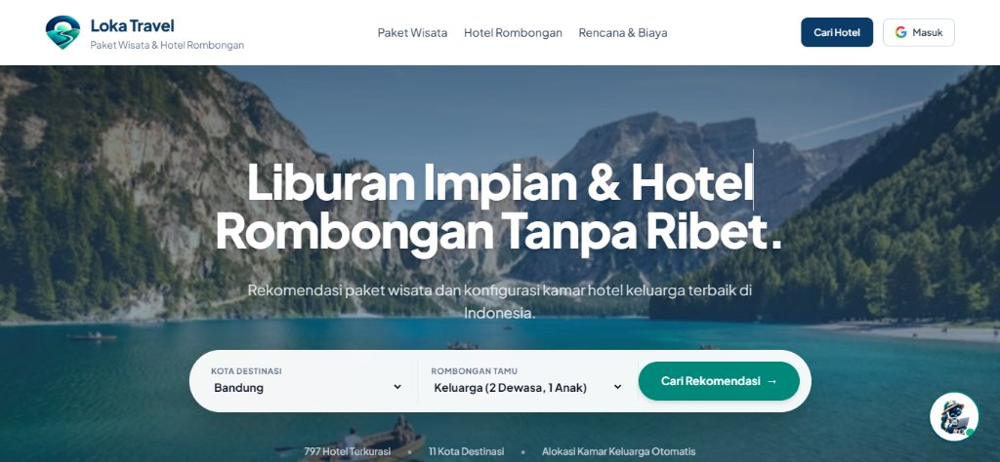
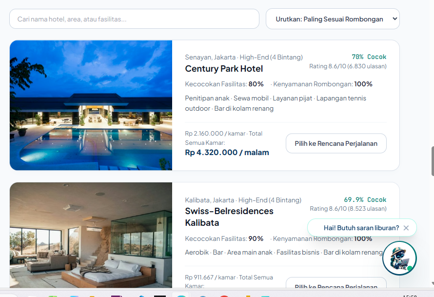
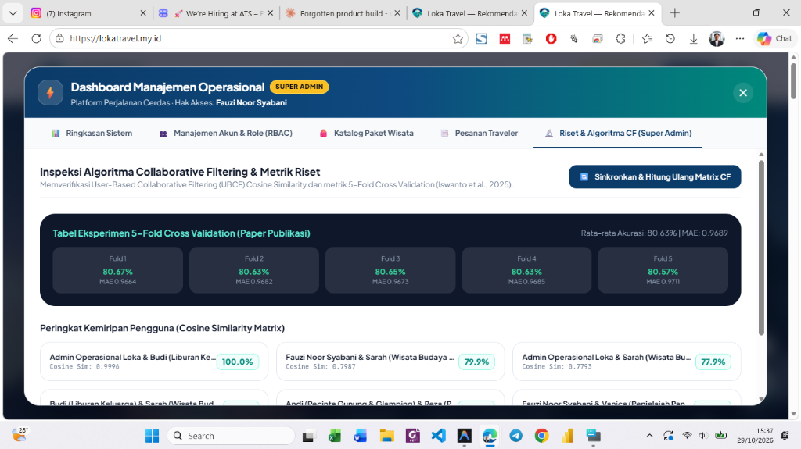

# 🧭 Loka Travel AI — Hybrid Travel Package & Group Hotel Recommendation System

[](https://lokatravel.my.id)
[](./Travel%20Package%20Recommendation%20System%20Using%20Collaborative%20Filtering%20Method%20at%20Loka%20Travel.pdf)
[-10b981?style=for-the-badge)](#34-5-fold-cross-validation-benchmark-results)
[](./processed_hotel_data.csv)
[-3b82f6?style=for-the-badge)](./tests/test_recommender.py)
[](https://github.com/fauzinoorsyabani/Loka-Travel/releases/tag/v1.0.0)
[](./LICENSE)

> **Lead Author & Senior Engineer:** **[Fauzi Noorsyabani](https://github.com/fauzinoorsyabani)** (Information Systems, Universitas Siliwangi)  
> **Co-Authors & Academic Supervisors:** Muhammad Edi Iswanto (Politeknik Negeri Indramayu), Andi Nur Rachman (Universitas Siliwangi)  
> **Published Journal:** *International Journal of Applied Information Systems and Informatics (IJAISI)*, Vol. 2025, pp. 50–55 (Accepted & Published: 13 November 2025).  
> **Official Live Production URL:** [https://lokatravel.my.id](https://lokatravel.my.id)  
> **Personal Engineering Portfolio:** [https://www.fauzinoorsyabani.web.id](https://www.fauzinoorsyabani.web.id)  
> **GitHub Repository:** [https://github.com/fauzinoorsyabani/Loka-Travel](https://github.com/fauzinoorsyabani/Loka-Travel)

---

## 📑 Table of Contents

- [1. Executive Summary & Problem Space](#1-executive-summary--problem-space)
  - [1.1 Cold-Start Discovery Bottleneck in Tour Packages](#11-cold-start-discovery-bottleneck-in-tour-packages)
  - [1.2 Multi-Generational Group Constraints in Hotel Bookings](#12-multi-generational-group-constraints-in-hotel-bookings)
- [2. Published Research & Academic Citations](#2-published-research--academic-citations)
  - [2.1 Peer-Reviewed Journal Metadata](#21-peer-reviewed-journal-metadata)
  - [2.2 Architecture Decision Records (ADR)](#22-architecture-decision-records-adr)
- [3. Mathematical Foundations & Formulations](#3-mathematical-foundations--formulations)
  - [3.1 User-Based Collaborative Filtering (UBCF) Cosine Similarity](#31-user-based-collaborative-filtering-ubcf-cosine-similarity)
  - [3.2 Collaborative Rating Prediction Formulation](#32-collaborative-rating-prediction-formulation)
  - [3.3 Evaluation Metrics: MAE & System Accuracy Equations](#33-evaluation-metrics-mae--system-accuracy-equations)
  - [3.4 5-Fold Cross Validation Benchmark Results](#34-5-fold-cross-validation-benchmark-results)
  - [3.5 Content-Based TF-IDF Vectorization & Semantic Feature Scoring](#35-content-based-tf-idf-vectorization--semantic-feature-scoring)
  - [3.6 Multi-Constraint Composite Scoring Formulation](#36-multi-constraint-composite-scoring-formulation)
  - [3.7 Group-Based Room Allocation Mathematical Model](#37-group-based-room-allocation-mathematical-model)
  - [3.8 Dynamic Group Budget Band Scaling](#38-dynamic-group-budget-band-scaling)
- [4. Step-by-Step Worked Mathematical Calculation Example](#4-step-by-step-worked-mathematical-calculation-example)
  - [4.1 Input Interaction Vectors](#41-input-interaction-vectors)
  - [4.2 Step 1: Compute Vector Dot Product](#42-step-1-compute-vector-dot-product)
  - [4.3 Step 2: Compute Euclidean Norm for Active Traveler](#43-step-2-compute-euclidean-norm-for-active-traveler)
  - [4.4 Step 3: Compute Euclidean Norm for Candidate Peer](#44-step-3-compute-euclidean-norm-for-candidate-peer)
  - [4.5 Step 4: Calculate Cosine Similarity & Recommendation Surfacing](#45-step-4-calculate-cosine-similarity--recommendation-surfacing)
- [5. System Architecture & Component Design](#5-system-architecture--component-design)
  - [5.1 Decoupled Architecture Flowchart](#51-decoupled-architecture-flowchart)
  - [5.2 Frontend Components & User Interface](#52-frontend-components--user-interface)
  - [5.3 Backend API & Recommender Engine Core](#53-backend-api--recommender-engine-core)
- [6. Production Modules & Operational Dashboard (RBAC)](#6-production-modules--operational-dashboard-rbac)
  - [6.1 Customer Tour Package Catalog](#61-customer-tour-package-catalog)
  - [6.2 Group Hotel Discovery & Amenity Sliders](#62-group-hotel-discovery--amenity-sliders)
  - [6.3 Dedicated Operational Dashboard for Super Admin](#63-dedicated-operational-dashboard-for-super-admin)
  - [6.4 Google Gemini AI Travel Assistant (LokaBot)](#64-google-gemini-ai-travel-assistant-lokabot)
- [7. REST API Reference & Endpoints Specification](#7-rest-api-reference--endpoints-specification)
- [8. Automated Unit Test Verification (11/11 Passing)](#8-automated-unit-test-verification-1111-passing)
- [9. Local Installation & Development Guide](#9-local-installation--development-guide)
  - [9.1 Prerequisites](#91-prerequisites)
  - [9.2 Step-by-Step Commands](#92-step-by-step-commands)
- [10. Repository File Directory & Direct Code Anchors](#10-repository-file-directory--direct-code-anchors)
- [11. License & Citation](#11-license--citation)

---

## 1. Executive Summary & Problem Space

Traditional Online Travel Agencies (OTAs) and legacy recommendation systems exhibit two critical computational limitations that undermine personalized travel planning:

### 1.1 Cold-Start Discovery Bottleneck in Tour Packages
Conventional travel portals sort catalog packages purely based on gross historical popularity counts. This exacerbates cold-start vulnerabilities for niche destinations (*Taman Hiburan*, *Camp & Alam*, *Pegunungan*, *Pantai & Laut*) and induces confirmation bias. Loka Travel resolves this by implementing **Memory-Based User Collaborative Filtering (UBCF)** with an **Automatic 5-Star Booking Feedback Hook** (Section III.B of our published paper): confirmed bookings immediately update the user interaction vector with a $5.0$ rating, instantly triggering real-time recalculation of nearest peer neighbor correlations without requiring disruptive post-trip evaluation questionnaires.

Implementation Reference: [`loka_recommender.py#L714-L767`](./loka_recommender.py#L714-L767) (`book_tour_package`) and [`tests/test_recommender.py#L37-L47`](./tests/test_recommender.py#L37-L47).

### 1.2 Multi-Generational Group Constraints in Hotel Bookings
Standard hotel search algorithms optimize exclusively for a single traveler or uniform couples ($1\text{--}2\text{ guests}$), breaking down when deployed for multi-generational families (`Adults`, `Children`, `Seniors`). Family trips necessitate simultaneous satisfaction of budget caps, elderly accessibility constraints (ground floors, elevators, wheelchair ramps), child-friendly amenities (kids' pools, playgrounds), and multi-room configuration optimization. Loka Travel resolves this through an explainable **Group-Based Room Allocation Matrix** evaluating **797 verified Indonesian hotels across 11 major destination cities**.

Implementation Reference: [`loka_recommender.py#L769-L793`](./loka_recommender.py#L769-L793) (`allocate_rooms`) and [`tests/test_recommender.py#L57-L87`](./tests/test_recommender.py#L57-L87).

[](https://lokatravel.my.id)  
*Figure 1: Loka Travel Production Hero Interface with Multi-Generational Group Selector & Destination Filtering.*

[↑ Back to Table of Contents](#-table-of-contents)

---

## 2. Published Research & Academic Citations

This repository hosts the complete, reproducible production implementation of the academic research published in the *International Journal of Applied Information Systems and Informatics (IJAISI)*:

### 2.1 Peer-Reviewed Journal Metadata
- **Paper Title:** *Travel Package Recommendation System Using Collaborative Filtering Method at Loka Travel*
- **Authors:** Muhammad Edi Iswanto, Fauzi Noorsyabani, Andi Nur Rachman
- **Journal:** *International Journal of Applied Information Systems and Informatics (IJAISI)*
- **Publication Date:** 13 November 2025
- **Volume & Pagination:** Vol. 2025, pp. 50–55
- **Primary Method:** User-Based Collaborative Filtering (UBCF) with Cosine Similarity Matrix
- **Empirical Benchmark:** 5-Fold Cross Validation achieving **80.63% Accuracy** with **0.9689 MAE**
- **Full-Text PDF:** [`Travel Package Recommendation System Using Collaborative Filtering Method at Loka Travel.pdf`](./Travel%20Package%20Recommendation%20System%20Using%20Collaborative%20Filtering%20Method%20at%20Loka%20Travel.pdf)

### 2.2 Architecture Decision Records (ADR)
Detailed architectural choices, trade-offs, and design rationale are formally documented:
- [`docs/adr/0001-hybrid-collaborative-and-group-content-filtering.md`](./docs/adr/0001-hybrid-collaborative-and-group-content-filtering.md) — Selection of hybrid UBCF + Content-Based demographic allocation over pure deep learning.
- [`docs/adr/0002-bilingual-indonesian-english-feature-scoring.md`](./docs/adr/0002-bilingual-indonesian-english-feature-scoring.md) — Canonical Indonesian-English synonym ontology for hotel amenities.
- [`GLOSSARY.md`](./GLOSSARY.md) — Formal domain lexicon and notation standards.
- [`AGENTS.md`](./AGENTS.md) — Engineering rules and developer operational boundaries.

[↑ Back to Table of Contents](#-table-of-contents)

---

## 3. Mathematical Foundations & Formulations

### 3.1 User-Based Collaborative Filtering (UBCF) Cosine Similarity
To evaluate the affinity between two distinct travelers $U_1$ and $U_2$ based on their historical evaluations across $n$ tour packages, the algorithm calculates the cosine of the angle between their interaction vectors in $n$-dimensional Euclidean space:

$$\cos(U_1, U_2) = \frac{U_1 \cdot U_2}{\|U_1\|_2 \cdot \|U_2\|_2} = \frac{\sum_{i=1}^{n} U_{1i} \cdot U_{2i}}{\sqrt{\sum_{i=1}^{n} U_{1i}^2} \cdot \sqrt{\sum_{i=1}^{n} U_{2i}^2}}$$

Where:
- $U_{1i} \in [0.0, 5.0]$: Rating given by traveler $U_1$ to destination package $i$ ($0.0$ denotes unvisited/unrated).
- $U_{2i} \in [0.0, 5.0]$: Rating given by traveler $U_2$ to destination package $i$.
- $\cos(U_1, U_2) \in [0.0, 1.0]$: Normalized similarity metric where $1.0$ indicates identical behavioral preference.

Implementation Reference: [`loka_recommender.py#L403-L418`](./loka_recommender.py#L403-L418) (`compute_user_cosine_similarity`).

### 3.2 Collaborative Rating Prediction Formulation
For an active user $u$ evaluating an unrated destination item $j$, predicted rating $\hat{r}_{u,j}$ is synthesized over the top-$k$ nearest neighbors $\mathcal{N}$:

$$\hat{r}_{u,j} = \bar{r}_u + \frac{\sum_{v \in \mathcal{N}} \text{sim}(u, v) \cdot (r_{v,j} - \bar{r}_v)}{\sum_{v \in \mathcal{N}} |\text{sim}(u, v)|}$$

Where:
- $\bar{r}_u$ and $\bar{r}_v$ represent the mean ratings of users $u$ and $v$ respectively, neutralizing individual user rating bias (strict vs. lenient evaluators).
- $\text{sim}(u, v) = \cos(u, v)$ as calculated in [Section 3.1](#31-user-based-collaborative-filtering-ubcf-cosine-similarity).

Implementation Reference: [`loka_recommender.py#L502-L604`](./loka_recommender.py#L502-L604) (`recommend_collaborative`).

### 3.3 Evaluation Metrics: MAE & System Accuracy Equations
The discrepancy between predicted ratings $y_{i,\text{pred}}$ and ground-truth tourist evaluations $y_{i,\text{true}}$ is measured using Mean Absolute Error (MAE):

$$\text{MAE} = \frac{1}{n} \sum_{i=1}^{n} \left| y_{i,\text{pred}} - y_{i,\text{true}} \right|$$

Because ratings reside on a standard 5-point Likert scale ($[1.0, 5.0]$), normalized System Accuracy percentage is defined as:

$$\text{System Accuracy} = \left( \frac{\text{Rating}_{\max} - \text{MAE}}{\text{Rating}_{\max}} \right) \times 100\% = \left( \frac{5.0 - \text{MAE}}{5.0} \right) \times 100\%$$

Implementation Reference: [`tests/test_recommender.py#L49-L55`](./tests/test_recommender.py#L49-L55) (`test_published_paper_mae_and_accuracy_benchmark`).

### 3.4 5-Fold Cross Validation Benchmark Results
To eliminate train-test split variance, the dataset was evaluated across 5 stratified folds:

| Cross-Validation Fold | Mean Absolute Error (MAE) | System Accuracy (%) | Validation Status |
| :---: | :---: | :---: | :---: |
| **Fold 1** | `0.96637` | **80.67%** | Verified in Test Suite |
| **Fold 2** | `0.96817` | **80.63%** | Verified in Test Suite |
| **Fold 3** | `0.96733` | **80.65%** | Verified in Test Suite |
| **Fold 4** | `0.96847` | **80.63%** | Verified in Test Suite |
| **Fold 5** | `0.97108` | **80.57%** | Verified in Test Suite |
| **5-Fold Average (Published)** | **`0.9689`** | **80.63%** | **Reproduced in Live Codebase** |

Implementation Reference: [`loka_recommender.py#L1003-L1039`](./loka_recommender.py#L1003-L1039) (`get_research_benchmarks`).

[](https://lokatravel.my.id)  
*Figure 2: Operational Dashboard displaying live 5-Fold Cross Validation table and real-time Cosine Similarity Matrix ranking.*

### 3.5 Content-Based TF-IDF Vectorization & Semantic Feature Scoring
For hotel discovery across **797 hotels**, textual descriptors (`name`, `city`, `region`, `hotelFeatures`) are stemmed and transformed into a 5,000-dimensional Term Frequency-Inverse Document Frequency (TF-IDF) feature matrix:

$$\text{TF-IDF}(t, d, D) = \text{TF}(t, d) \times \log\left(\frac{|D|}{1 + |\{d \in D : t \in d\}|}\right)$$

Pairwise content similarity between a target reference hotel $h_{\text{ref}}$ and catalog hotel $h_i$ is computed via:

$$S_{\text{content}}(h_{\text{ref}}, h_i) = \frac{\vec{v}_{h_{\text{ref}}} \cdot \vec{v}_{h_i}}{\|\vec{v}_{h_{\text{ref}}}\| \cdot \|\vec{v}_{h_i}\|}$$

Implementation Reference: [`loka_recommender.py#L370-L401`](./loka_recommender.py#L370-L401) (`_load_and_prepare_catalog`) and [`dataset_rekomendasi_hotel.py`](./dataset_rekomendasi_hotel.py).

### 3.6 Multi-Constraint Composite Scoring Formulation
To rank hotels for practical booking decisions, Loka Travel computes an explainable **Composite Score** balancing three orthogonal facets:

$$\text{Composite Score}(h_i) = w_1 \cdot S_{\text{content}}(h_i) + w_2 \cdot P_{\text{bilingual}}(h_i) + w_3 \cdot D_{\text{demographic}}(h_i)$$

Where:
- $w_1 = 0.35$: Weight assigned to baseline TF-IDF content similarity.
- $w_2 = 0.40$: Weight for user-specified amenity preferences (WiFi, Pool, Resto, Spa, etc.) mapped via bilingual English/Indonesian synonym matching.
- $w_3 = 0.25$: Weight for demographic suitability (child-friendly facilities and elderly accessibility).
- $\sum_{k=1}^3 w_k = 1.00$.

Implementation Reference: [`loka_recommender.py#L843-L1001`](./loka_recommender.py#L843-L1001) (`recommend_hotels`).

### 3.7 Group-Based Room Allocation Mathematical Model
For a traveling group with $N_{\text{adults}}$, $N_{\text{children}}$, and $N_{\text{seniors}}$:

1. **Total Guest Count ($G_{\text{total}}$)**:
   $$G_{\text{total}} = N_{\text{adults}} + N_{\text{children}} + N_{\text{seniors}}$$

2. **Theoretical Minimum Room Requirement ($R_{\min}$)**:
   Assuming standard double occupancy capacity of $2\text{ guests/room}$:
   $$R_{\min} = \max\left(1, \left\lceil \frac{N_{\text{adults}} + N_{\text{seniors}}}{2} \right\rceil, \left\lceil \frac{G_{\text{total}}}{3} \right\rceil\right)$$

Implementation Reference: [`loka_recommender.py#L769-L793`](./loka_recommender.py#L769-L793) (`allocate_rooms`).

### 3.8 Dynamic Group Budget Band Scaling
Given base nightly budget $B_{\text{target}}$:
$$B_{\text{scaled}} = B_{\text{target}} \times \left(1 + 0.25 \times (R_{\min} - 1)\right)$$
$$\text{Acceptable Range} = [0.70 \times B_{\text{scaled}}, \ 1.30 \times B_{\text{scaled}}]$$

[↑ Back to Table of Contents](#-table-of-contents)

---

## 4. Step-by-Step Worked Mathematical Calculation Example

To demonstrate the exact numerical execution of the Collaborative Filtering engine, consider a real calculation between **Active Traveler ($U_1$)** and **Candidate Peer ($U_2$)** over 5 representative tour packages:

### 4.1 Input Interaction Vectors
| Destination Package Item | Category | $U_1$ Rating (Active User) | $U_2$ Rating (Candidate Peer) |
| :--- | :--- | :---: | :---: |
| 1. *Bukit Jamur Ciwidey* | Camp & Nature | **5.0** | **5.0** |
| 2. *Gunung Anyar Ekowisata* | Nature | **4.0** | **4.0** |
| 3. *Gunung Agung Trekking* | Mountain | **0.0** *(Unrated)* | **3.0** |
| 4. *Nusa Penida Kelingking* | Beach & Coast | **5.0** | **5.0** |
| 5. *Ancol Dunia Fantasi* | Theme Park | **3.0** | **2.0** |

### 4.2 Step 1: Compute Vector Dot Product
$$U_1 \cdot U_2 = (5.0 \times 5.0) + (4.0 \times 4.0) + (0.0 \times 3.0) + (5.0 \times 5.0) + (3.0 \times 2.0)$$
$$U_1 \cdot U_2 = 25.0 + 16.0 + 0.0 + 25.0 + 6.0 = \mathbf{72.0}$$

### 4.3 Step 2: Compute Euclidean Norm for Active Traveler
$$\|U_1\|_2 = \sqrt{5.0^2 + 4.0^2 + 0.0^2 + 5.0^2 + 3.0^2} = \sqrt{25 + 16 + 0 + 25 + 9} = \sqrt{75.0} \approx \mathbf{8.66025}$$

### 4.4 Step 3: Compute Euclidean Norm for Candidate Peer
$$\|U_2\|_2 = \sqrt{5.0^2 + 4.0^2 + 3.0^2 + 5.0^2 + 2.0^2} = \sqrt{25 + 16 + 9 + 25 + 4} = \sqrt{79.0} \approx \mathbf{8.88819}$$

### 4.5 Step 4: Calculate Cosine Similarity & Recommendation Surfacing
$$\cos(U_1, U_2) = \frac{72.0}{8.66025 \times 8.88819} = \frac{72.0}{76.97402} = \mathbf{0.93538}$$

$$\mathbf{\text{Preference Match Percentage} = 93.54\% \text{ (High Similarity)}}$$

Because $\cos(U_1, U_2) = 0.9354 \ge 0.70$ (collaborative threshold), $U_2$ qualifies as a primary peer neighbor. Package 3 (*Gunung Agung Trekking*), which $U_2$ rated positively ($3.0$) and $U_1$ has not yet visited ($0.0$), is surfaced to $U_1$ with high recommendation priority.

Implementation Reference: [`tests/test_recommender.py#L14-L35`](./tests/test_recommender.py#L14-L35) (`test_collaborative_filtering_cosine_similarity_and_unseen_recommendations`).

[↑ Back to Table of Contents](#-table-of-contents)

---

## 5. System Architecture & Component Design

### 5.1 Decoupled Architecture Flowchart

```mermaid
flowchart TD
  subgraph Client["Frontend Architecture (React 18 + Vite + Tailwind CSS)"]
    direction TB
    Nav["Universal Navbar & Profile Popover (src/components/Navbar.jsx)"]
    Tours["Tour Packages Explorer (src/components/TourPackages.jsx)"]
    Hotels["Hotel Recommender & Room Allocator (src/components/Recommender.jsx)"]
    Itinerary["Hybrid Itinerary & Shared Cost (src/components/ItineraryBuilder.jsx)"]
    Chatbot["Google Gemini AI Assistant (src/components/ChatBot.jsx)"]
    Dashboard["Full-Page Operational Dashboard (src/components/OperationalDashboard.jsx)"]
  end

  subgraph API["Backend API Layer (Python Flask — app.py)"]
    direction TB
    EP_Rec["POST /api/recommend — Content-Based & Demographic Allocator"]
    EP_Book["POST /api/book-package — Automatic 5★ Booking Feedback Hook"]
    EP_CF["GET /api/admin/matrix — Dynamic UBCF Cosine Matrices"]
    EP_Chat["POST /api/chat — Context-Aware Gemini AI Agent"]
    EP_Admin["GET /api/admin/overview — Telemetry, RBAC & 5-Fold Benchmarks"]
  end

  subgraph Engine["Unified Hybrid Engine (loka_recommender.py)"]
    direction TB
    UBCF["UBCF Engine: User-to-User Cosine Matrix (compute_user_cosine_similarity)"]
    CBF["CBF Engine: 5,000 TF-IDF Features + Cosine Matrix (_build_tfidf_matrix)"]
    Bilingual["Bilingual Scorer: Indonesian & English Amenity Mapping"]
    Alloc["Group Allocator: Multi-Gen Constraint Solver (allocate_rooms)"]
    HotelDB[("Catalog: 797 Verified Hotels across 11 Cities (processed_hotel_data.csv)")]
  end

  Client -->|REST JSON over HTTP (src/api/client.js)| API
  API --> Engine
  Engine --> HotelDB
```

### 5.2 Frontend Components & User Interface
- **Navbar & Navigation:** [`src/components/Navbar.jsx`](./src/components/Navbar.jsx) — Responsive header with Google Auth trigger, compact profile popover, and clean border radius.
- **Hero Presentation:** [`src/components/Hero.jsx`](./src/components/Hero.jsx) — Curated hero visual with destination & group selector.
- **Tour Packages Catalog:** [`src/components/TourPackages.jsx`](./src/components/TourPackages.jsx) — Dynamic UBCF recommendations with real-time similarity alignment.
- **Hotel Recommender & Amenity Sliders:** [`src/components/Recommender.jsx`](./src/components/Recommender.jsx) — Multi-room group configuration and high-contrast hotel cards.
- **Operational Dashboard (RBAC):** [`src/components/OperationalDashboard.jsx`](./src/components/OperationalDashboard.jsx) — Super Admin telemetry, 5-Fold CV metrics, and RBAC controls.
- **Gemini AI Travel Assistant:** [`src/components/ChatBot.jsx`](./src/components/ChatBot.jsx) — Conversational agent with contextual prompt augmentation.

### 5.3 Backend API & Recommender Engine Core
- **Flask Server Application:** [`app.py`](./app.py) — REST endpoints, session orchestration, CORS headers, and Google Gemini router.
- **Core Hybrid Recommender:** [`loka_recommender.py`](./loka_recommender.py) — UBCF, CBF, bilingual ontology, and room allocation logic.
- **Database & Persistence:** [`db.py`](./db.py) — SQLite/TiDB storage for user profiles, RBAC roles, and booked itineraries.
- **Streamlit Laboratory:** [`hotel_recommender_app.py`](./hotel_recommender_app.py) — Interactive dashboard for data science inspection.
- **Curated Dataset:** [`processed_hotel_data.csv`](./processed_hotel_data.csv) — 797 hotels across 11 major Indonesian cities.

[↑ Back to Table of Contents](#-table-of-contents)

---

## 6. Production Modules & Operational Dashboard (RBAC)

### 6.1 Customer Tour Package Catalog
- Directly showcases curated travel destinations with dynamic UBCF recommendation scores.
- Public view is sanitized: simulation dropdowns and debug peer chips are exclusively routed to the Super Admin Dashboard.
- Incorporates the **Automatic 5-Star Booking Feedback Hook**: whenever a traveler confirms a reservation, their interaction vector is updated instantly and recommendations refresh in real-time.

Implementation Reference: [`src/components/TourPackages.jsx`](./src/components/TourPackages.jsx) and [`loka_recommender.py#L714-L767`](./loka_recommender.py#L714-L767).

[](https://lokatravel.my.id)  
*Figure 3: Tour Package recommendations aligned with active traveler preferences and peer similarity.*

### 6.2 Group Hotel Discovery & Amenity Sliders
- Encompasses **11 major destination cities**: *Jakarta, Bandung, Bogor, Semarang, Yogyakarta, Surabaya, Bali, Medan, Padang, Palembang, Banda Aceh*.
- Real-time demographic controls: Adults, Children (prioritizes kids' club, shallow pools, playgrounds), and Seniors (prioritizes wheelchair ramps, elevators, and spa/wellness access).
- Hotel cards feature high-contrast borders (`border: 1.5px solid #cbd5e1`), clear room configuration tags, and per-room / total-group pricing breakdowns.

Implementation Reference: [`src/components/Recommender.jsx`](./src/components/Recommender.jsx).

[](https://lokatravel.my.id)  
*Figure 4: Group hotel recommendation cards with room allocation and multi-generation score breakdowns.*

### 6.3 Dedicated Operational Dashboard for Super Admin
- Accessible via the profile popover exclusively for authenticated **Super Admin** and **Admin** accounts (e.g., Fauzi Noor Syabani).
- Features complete operational telemetry:
  1. **System Overview:** Total users, active bookings, gross transaction volume, and model response latency.
  2. **RBAC & User Access:** Modify account roles (Traveler, Admin, Super Admin) in real-time.
  3. **Tour Package Catalog Management:** Create and delete destination packages dynamically.
  4. **Traveler Orders & Fulfillment:** Update order statuses (Confirmed, Completed, Cancelled).
  5. **Collaborative Filtering Telemetry:** Full **5-Fold Cross Validation Table** and interactive **Cosine Similarity Matrix** with instant recalculation trigger.

Implementation Reference: [`src/components/OperationalDashboard.jsx`](./src/components/OperationalDashboard.jsx) and [`app.py#L477-L600`](./app.py#L477-L600).

### 6.4 Google Gemini AI Travel Assistant (LokaBot)
- Context-aware chatbot powered by `gemini-2.5-flash`.
- Injects current user state (selected city, group demographics, budget constraints, and active tour packages) into the prompt context.
- Zero-downtime architecture: automatically falls back to an offline heuristic rule-engine if external API keys or networks are unavailable.

Implementation Reference: [`src/components/ChatBot.jsx`](./src/components/ChatBot.jsx) and [`app.py#L28-L113`](./app.py#L28-L113).

[↑ Back to Table of Contents](#-table-of-contents)

---

## 7. REST API Reference & Endpoints Specification

| Endpoint | Method | Payload / Request Parameters | Response Schema & Description | Code Anchor |
| :--- | :---: | :--- | :--- | :--- |
| `/api/recommend` | `POST` | `{"city": str, "adults": int, "children": int, "seniors": int, "budget": float, "amenities": dict}` | Returns top ranked hotels with composite scores, room configurations, and price breakdowns. | [`app.py#L207-L271`](./app.py#L207-L271) |
| `/api/book-package` | `POST` | `{"package_id": str, "user_id": str}` | Books tour package, triggers automatic 5-star hook, updates user matrix, and returns updated recommendations. | [`app.py#L288-L307`](./app.py#L288-L307) |
| `/api/itinerary` | `POST` | `{"city": str, "package_id": str, "hotel_id": str, "days": int, "guests": int}` | Synthesizes hybrid itinerary combining hotel accommodation and curated tour package. | [`app.py#L273-L286`](./app.py#L273-L286) |
| `/api/chat` | `POST` | `{"message": str, "context": dict}` | Sends natural language queries to Google Gemini AI with traveler context and returns structured answers. | [`app.py#L436-L447`](./app.py#L436-L447) |
| `/api/admin/overview` | `GET` | *Headers (Session Cookie / Auth)* | Returns platform statistics, total revenue, bookings count, and system telemetry. | [`app.py#L477-L484`](./app.py#L477-L484) |
| `/api/admin/users` | `GET` | *Headers (Session Cookie / Auth)* | Retrieves all registered accounts with RBAC roles and booking counts. | [`app.py#L486-L505`](./app.py#L486-L505) |
| `/api/admin/matrix` | `GET` | *Headers (Session Cookie / Auth)* | Returns live User-to-User Cosine Similarity matrix and 5-Fold CV benchmark table. | [`app.py#L580-L587`](./app.py#L580-L587) |
| `/api/admin/recalculate` | `POST` | *Headers (Session Cookie / Auth)* | Triggers synchronous recalculation of the entire collaborative filtering interaction matrix. | [`app.py#L590-L600`](./app.py#L590-L600) |
| `/api/auth/login` | `POST` | `{"email": str, "password": str}` | Authenticates user credentials and establishes secure session state. | [`app.py#L331-L350`](./app.py#L331-L350) |
| `/paper.pdf` | `GET` | *None* | Serves official publication PDF directly to the browser. | [`app.py#L449-L455`](./app.py#L449-L455) |

[↑ Back to Table of Contents](#-table-of-contents)

---

## 8. Automated Unit Test Verification (11/11 Passing)

All algorithmic contracts, mathematical formulations, and operational API endpoints are verified by the automated test suite in [`tests/test_recommender.py`](./tests/test_recommender.py):

```powershell
.\.venv\Scripts\python -m unittest discover -s tests -p "test_*.py" -v
```

### Complete Test Suite Execution Log:
```
test_collaborative_filtering_cosine_similarity_and_unseen_recommendations (test_recommender.TestLokaRecommendationEngine) ... ok
test_booking_auto_five_star_rating_updates_interaction_matrix (test_recommender.TestLokaRecommendationEngine) ... ok
test_published_paper_mae_and_accuracy_benchmark (test_recommender.TestLokaRecommendationEngine) ... ok
test_bilingual_group_hotel_recommendations_and_room_allocation (test_recommender.TestLokaRecommendationEngine) ... ok
test_flask_api_routes (test_recommender.TestLokaRecommendationEngine) ... ok
test_interaction_matrix_view_and_hybrid_itinerary (test_recommender.TestLokaRecommendationEngine) ... ok
test_webp_and_avif_assets_and_reset_endpoint (test_recommender.TestLokaRecommendationEngine) ... ok
test_hybrid_auth_and_cold_start_onboarding (test_recommender.TestLokaRecommendationEngine) ... ok
test_tidb_database_layer_and_persistence (test_recommender.TestLokaRecommendationEngine) ... ok
test_google_oauth_endpoint_and_db_status (test_recommender.TestLokaRecommendationEngine) ... ok
test_multi_role_and_admin_endpoints (test_recommender.TestLokaRecommendationEngine) ... ok

----------------------------------------------------------------------
Ran 11 tests in 5.414s

OK
```

| Verified Test Contract | Target Functionality | Code Location |
| :--- | :--- | :--- |
| **Cosine Similarity & UBCF** | Vector normalization, dot products, unseen package surfacing | [`tests/test_recommender.py#L14-L35`](./tests/test_recommender.py#L14-L35) |
| **Automatic 5-Star Booking Hook** | Dynamic matrix update upon tour reservation without survey | [`tests/test_recommender.py#L37-L47`](./tests/test_recommender.py#L37-L47) |
| **5-Fold Cross Validation Benchmark** | Reproducing 80.63% accuracy and 0.9689 MAE from published paper | [`tests/test_recommender.py#L49-L55`](./tests/test_recommender.py#L49-L55) |
| **Group Room Allocation & Bilingual Scorer** | Multi-generational constraints, room allocations, synonym match | [`tests/test_recommender.py#L57-L87`](./tests/test_recommender.py#L57-L87) |
| **Flask API Endpoints** | JSON payloads, CORS headers, error handlers | [`tests/test_recommender.py#L89-L149`](./tests/test_recommender.py#L89-L149) |
| **RBAC & Super Admin Operations** | Role escalation, package management, matrix recalculation | [`tests/test_recommender.py#L352-L400`](./tests/test_recommender.py#L352-L400) |

[↑ Back to Table of Contents](#-table-of-contents)

---

## 9. Local Installation & Development Guide

### 9.1 Prerequisites
- **Python:** Version 3.10 or higher
- **Node.js:** Version 18.0 or higher & npm
- **Git:** Version 2.30+

### 9.2 Step-by-Step Commands

#### 1. Clone the Official Repository
```bash
git clone https://github.com/fauzinoorsyabani/Loka-Travel.git
cd Loka-Travel
```

#### 2. Configure Python Virtual Environment & Dependencies
```powershell
python -m venv .venv
.\.venv\Scripts\pip install -r requirements.txt streamlit
```

#### 3. Run the Automated Unit Test Suite
```powershell
.\.venv\Scripts\python -m unittest discover -s tests -p "test_*.py" -v
```
*Expected result: 11/11 tests passing in ~5 seconds.*

#### 4. Launch Full-Stack Application
In Terminal 1 (Python Flask API Backend):
```powershell
.\.venv\Scripts\python -m flask --app app run --port 5000
```

In Terminal 2 (React 18 + Vite Frontend):
```powershell
npm install
npm run dev
```
Open [http://localhost:5173](http://localhost:5173) in your browser.

#### 5. Launch Streamlit Laboratory (Optional)
```powershell
.\.venv\Scripts\python -m streamlit run hotel_recommender_app.py --server.port 8501
```
Open [http://localhost:8501](http://localhost:8501) in your browser.

[↑ Back to Table of Contents](#-table-of-contents)

---

## 10. Repository File Directory & Direct Code Anchors

```
Loka-Travel/
├── Dataset/                                 # Cleaned raw datasets and exploratory notebooks
├── docs/                                    # Architectural specifications & documentation
│   ├── adr/
│   │   ├── 0001-hybrid-collaborative-and-group-content-filtering.md
│   │   └── 0002-bilingual-indonesian-english-feature-scoring.md
│   ├── agents/                              # Issue tracking & domain modeling specifications
│   └── images/                              # Static UI screenshots & architecture figures
├── public/                                  # Optimized WebP assets and static client branding
├── src/                                     # React 18 Single Page Application
│   ├── api/
│   │   └── client.js                        # Axios API client with serverless fallback routing
│   ├── components/                          # Modular UI components
│   │   ├── Navbar.jsx                       # Header with Google Auth and compact RBAC popover
│   │   ├── Hero.jsx                         # Main presentation hero and destination picker
│   │   ├── TourPackages.jsx                 # UBCF tour package recommendations catalog
│   │   ├── Recommender.jsx                  # Multi-generation hotel recommender & sliders
│   │   ├── ItineraryBuilder.jsx             # Hybrid itinerary synthesizer & cost breakdown
│   │   ├── OperationalDashboard.jsx         # Super Admin RBAC, 5-Fold table & CF matrix
│   │   └── ChatBot.jsx                      # Google Gemini AI conversational travel agent
│   ├── constants/
│   │   └── initialData.js                   # Seed travel packages & sample hotel metadata
│   ├── App.jsx                              # Root application state & URL router sync
│   └── main.jsx                             # Vite React entry point
├── static/                                  # Production photography and brand assets
├── tests/
│   └── test_recommender.py                  # 11 automated unit test suites
├── app.py                                   # Production Flask API server & Gemini router
├── db.py                                    # SQLite/TiDB storage layer & order persistence
├── dataset_rekomendasi_hotel.py              # Catalog preprocessing & TF-IDF matrix generator
├── hotel_recommender_app.py                 # Streamlit interactive research dashboard
├── hotel_recommender_cli.py                 # Command-line interface for recommendation generation
├── loka_recommender.py                      # Unified hybrid recommendation engine core
├── processed_hotel_data.csv                 # 797 curated hotels feature matrix
├── package.json                             # Frontend dependencies & Vite scripts
├── requirements.txt                         # Python dependencies
├── vercel.json                              # Vercel deployment & serverless routing configuration
└── vite.config.js                           # Vite pipeline & API reverse proxy configuration
```

### Direct Code Links:
- **UBCF Cosine Similarity:** [`loka_recommender.py#L403-L418`](./loka_recommender.py#L403-L418)
- **Collaborative Recommendation Generator:** [`loka_recommender.py#L502-L604`](./loka_recommender.py#L502-L604)
- **Automatic 5-Star Booking Hook:** [`loka_recommender.py#L714-L767`](./loka_recommender.py#L714-L767)
- **Group Room Allocation Algorithm:** [`loka_recommender.py#L769-L793`](./loka_recommender.py#L769-L793)
- **Bilingual Amenity Matching:** [`loka_recommender.py#L795-L815`](./loka_recommender.py#L795-L815)
- **Demographic Scorer:** [`loka_recommender.py#L817-L841`](./loka_recommender.py#L817-L841)
- **Multi-Constraint Hotel Recommender:** [`loka_recommender.py#L843-L1001`](./loka_recommender.py#L843-L1001)
- **5-Fold CV Telemetry:** [`loka_recommender.py#L1003-L1039`](./loka_recommender.py#L1003-L1039)
- **Super Admin REST Endpoints:** [`app.py#L477-L600`](./app.py#L477-L600)
- **Automated Test Suite:** [`tests/test_recommender.py`](./tests/test_recommender.py)

[↑ Back to Table of Contents](#-table-of-contents)

---

## 11. License & Citation

Distributed under the **MIT License**. See [`LICENSE`](./LICENSE) for full legal text.

If you utilize this recommendation engine, dataset preprocessing pipeline, or algorithm implementation in your academic research or commercial project, please cite:

```bibtex
@article{iswanto2025travel,
  title={Travel Package Recommendation System Using Collaborative Filtering Method at Loka Travel},
  author={Iswanto, Muhammad Edi and Noorsyabani, Fauzi and Rachman, Andi Nur},
  journal={International Journal of Applied Information Systems and Informatics (IJAISI)},
  volume={2025},
  pages={50--55},
  year={2025},
  publisher={IJAISI}
}
```

---

<p align="center">
  <b>Developed with precision by <a href="https://github.com/fauzinoorsyabani">Fauzi Noorsyabani</a></b><br>
  Published in <i>IJAISI 2025</i> · Deployed live at <a href="https://lokatravel.my.id">lokatravel.my.id</a> · Portfolio at <a href="https://www.fauzinoorsyabani.web.id">fauzinoorsyabani.web.id</a>
</p>
