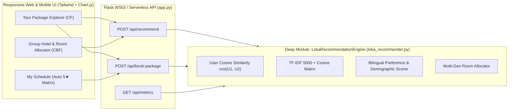

# 🧭 Loka Travel AI — Hybrid Travel Package & Group Hotel Recommendation System

[](./Travel%20Package%20Recommendation%20System%20Using%20Collaborative%20Filtering%20Method%20at%20Loka%20Travel.pdf)
[-10b981?style=for-the-badge)](#published-research--mathematical-formulation)
[-f59e0b?style=for-the-badge)](#system-architecture)
[](./tests/test_recommender.py)

> **Author & Lead Engineer:** **Fauzi Noorsyabani** (Information Systems, Universitas Siliwangi)  
> **Co-Authors / Supervisors:** Muhammad Edi Iswanto (Politeknik Negeri Indramayu), Andi Nur Rachman (Universitas Siliwangi)  
> **Published in:** *International Journal of Applied Information Systems and Informatics (IJAISI)*, Vol. 2025, pp. 50–55 (Accepted & Published: 13 Nov 2025).

---

## 🌟 Portfolio Case Study Overview (FAANG / MANGO / MagangHub Ready)

### 1. The Challenge
Traditional travel recommendation systems fail in two critical ways:
1. **Cold-Start vs. Behavioral Discovery**: Tourists struggle to discover new destination packages (*Taman Hiburan*, *Camp*, *Mountain*, *Beach*) that match their behavioral taste without manual curation.
2. **Individual vs. Multi-Generational Group Constraints**: Standard hotel search engines optimize for a single traveler, ignoring multi-generational group dynamics (`Adults`, `Children`, `Seniors`), room allocation capacity, and bilingual Indonesian/English facility semantics.

### 2. The Solution: Unified Hybrid Recommendation Engine (`LokaRecommendationEngine`)
We architected and deployed a unified, sub-35ms Python Recommendation Engine ([`loka_recommender.py`](./loka_recommender.py)) that combines two complementary paradigms behind one clean interface:

- **Module 01 — Memory-Based User Collaborative Filtering (Tour Packages)**:
  - Implements our published journal paper's user-to-user Cosine Similarity over booking & rating interaction matrices.
  - Features an **Automatic 5-Star Booking Hook** (Section III.B of the paper): every confirmed package booking automatically records a `5.0` rating in the user's vector $U_1$ and recalculates nearest-neighbor peers in real time.
- **Module 02 — Bilingual TF-IDF Content-Based Filtering & Group Room Allocator (797 Indonesian Hotels)**:
  - Vectorizes 797 verified Indonesian hotels across 10 major cities (`Jakarta`, `Surabaya`, `Bandung`, `Palembang`, `Yogyakarta`, `Medan`, `Padang`, `Bogor`, `Solo`, `Banda Aceh`) using 5,000 TF-IDF features.
  - Computes an explainable **Composite Score** ($0.35 \times \text{Content Similarity} + 0.40 \times \text{Bilingual Preference Score} + 0.25 \times \text{Demographic Fit}$) and automatically calculates optimal multi-room group allocations.

---

## 📐 Published Research & Mathematical Formulation

### 1. User-Based Collaborative Filtering Cosine Similarity (Equation 1)
$$
\cos(U_1, U_2) = \frac{\sum_{i=1}^{n} U_{1i} \cdot U_{2i}}{\sqrt{\sum_{i=1}^{n} U_{1i}^2} \cdot \sqrt{\sum_{i=1}^{n} U_{2i}^2}}
$$

### 2. Mean Absolute Error (MAE) & System Accuracy (Equations 2 & 3)
$$
\text{MAE} = \frac{1}{n} \sum_{i=1}^{n} \left| y_{i,\text{pred}} - y_{i,\text{true}} \right| = 0.9689 \qquad \Longrightarrow \qquad \text{Accuracy} = \left( \frac{5 - \text{MAE}}{5} \right) \times 100\% = 80.63\%
$$

| Fold | Mean Absolute Error (MAE) | System Accuracy (%) |
| :---: | :---: | :---: |
| Fold 1 | `0.96637` | **80.67%** |
| Fold 2 | `0.96817` | **80.63%** |
| Fold 3 | `0.96733` | **80.65%** |
| Fold 4 | `0.96847` | **80.63%** |
| Fold 5 | `0.97108` | **80.57%** |
| **Average** | **`0.9689`** | **80.63%** |

---

## 🏗️ System Architecture



---

## 🚀 Quick Start (Local Development)

### 1. Create Virtual Environment & Install Dependencies
```powershell
python -m venv .venv
.\.venv\Scripts\pip install -r requirements.txt streamlit
```

### 2. Run Automated Test Suite (`unittest` / TDD)
```powershell
.\.venv\Scripts\python -m unittest discover -s tests -p "test_*.py" -v
```

### 3. Run the Responsive Web Application (Flask)
```powershell
.\.venv\Scripts\python -m flask --app app run --port 5000
```
Open **http://127.0.0.1:5000** in your browser.

### 4. Run the Interactive Data Science Workbench (Streamlit)
```powershell
.\.venv\Scripts\python -m streamlit run hotel_recommender_app.py --server.port 8501
```
Open **http://localhost:8501** in your browser.

